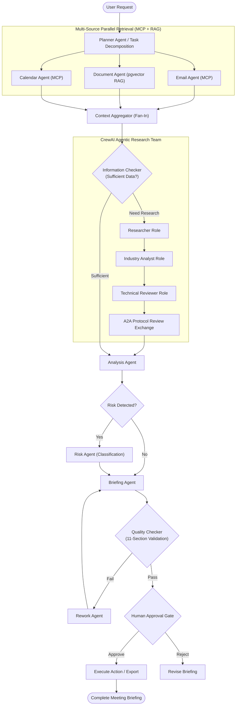

# OfficePilot: Multi-Agent Meeting Intelligence System

> An enterprise-grade, multi-agent meeting preparation and intelligence workflow orchestrating **Google Agent Development Kit (ADK)** and **CrewAI** via the **Agent-to-Agent (A2A)** protocol, powered by **Model Context Protocol (MCP)** tools, **PostgreSQL/pgvector** RAG retrieval, and strict Pydantic guardrails.

---

## 1. System Architecture

The OfficePilot workflow implements a hierarchical, state-sharing multi-agent architecture as illustrated below:



---

## 2. Requirements Compliance Matrix

Every single one of the 11 teacher-mandated requirements is fully implemented and verified in the codebase:

| # | Requirement | Implementation & Tech Stack | Verification Evidence |
|---|---|---|---|
| **1** | **Context Sharing & State Updates** | ADK session state & Pydantic models propagate intermediate data across agents. | `MeetingContext` schema in `backend/agents/schemas.py`, test in `test_client_request.py`. |
| **2** | **Tool Integration using MCP** | Model Context Protocol server exposing `search_emails`, `get_calendar`, and `discover_next_meeting`. | `backend/tools/mcp_server.py` & `backend/tools/mcp_client.py`, tests in `test_mcp_client.py` and `test_mcp_server.py`. |
| **3** | **Structured Output using Pydantic** | Strict Pydantic models for meeting context, briefings, and execution status. | Pydantic v2 models in `backend/agents/schemas.py` and `backend/agents/briefing_agent.py`. |
| **4** | **Agentic Design Patterns** | Task Decomposition, Parallel Fan-Out/Fan-In, Conditional Routing, HITL Gating, and Evaluator-Optimizer loops. | Implemented in `backend/agents/workflow.py`, `parallel_agents.py`, `router.py`, and `quality_checker.py`. |
| **5** | **Monitoring & Callbacks** | `OfficePilotLoggingPlugin` hooks tracking agent lifecycle, tool execution, model latencies, and token usage. | `backend/agents/observability.py`, verified in `test_observability.py`. |
| **6** | **Agent-to-Agent (A2A) Protocol** | Interoperable JSON-RPC card exchange between ADK coordinator and remote reviewer. | `backend/a2a_demo/client_agent.py` & `remote_agent.py`, verified in `test_crewai_a2a_workflow.py`. |
| **7** | **Dual Framework: CrewAI + ADK** | Google ADK orchestrates top-level workflow; CrewAI drives deep-dive research with 3 sequential specialized roles. | `backend/crewai_research/crew.py`, verified in `test_adk_crewai.py` & `test_crewai_a2a_workflow.py`. |
| **8** | **Guardrails & Security** | Prompt injection defenses, toxic language filtering, tenant isolation, and MCP type validation. | `validate_user_prompt` in `backend/agents/observability.py`, tests in `test_security_controls.py`. |
| **9** | **Observability & Tracing** | OpenTelemetry/Langfuse instrumentation for auditability and provenance. | `backend/agents/langfuse_setup.py`, verified in `test_observability.py`. |
| **10** | **Performance & Cost Evaluation** | Automated benchmarking tracking retrieval latencies, role execution times, and token cost models. | `backend/performance_eval.py` & `BENCHMARK_REPORT.md`, tested in `test_performance_eval.py`. |
| **11** | **Cloud Deployment Readiness** | Production-ready `Dockerfile`, `docker-compose.yml`, Azure Bicep IaC (`infra/main.bicep`), and `azure.yaml`. | Tested container configurations and deployment guides in `DEPLOYMENT.md`. |

---

## 3. Technology Stack

- **Agent Frameworks**: Google ADK (v2.9.0) + CrewAI (v1.15.23)
- **Protocol Interoperability**: Agent-to-Agent (A2A) Protocol + Model Context Protocol (MCP v1.28.1)
- **Language Models**: Ollama (`llama3.1` / `llama3.1:latest`) or Groq (`openai/gpt-oss-120b`)
- **Knowledge Base & RAG**: PostgreSQL 16 with `pgvector` extension + `sentence-transformers/all-MiniLM-L6-v2`
- **Backend API**: FastAPI + Uvicorn
- **Validation & Schemas**: Pydantic v2
- **Observability**: OpenTelemetry + Langfuse
- **Cloud Infrastructure**: Azure Container Apps / Docker Compose / Bicep IaC

---

## 4. Quick Start Guide

### Prerequisites
- Python 3.11+
- (Optional for live local LLM) [Ollama](https://ollama.ai/) with `llama3.1`

### 1. Installation
```bash
# Clone repository
git clone https://github.com/Prateek-yadav1/OfficePilot.git
cd OfficePilot

# Create and activate virtual environment
python3 -m venv .venv
source .venv/bin/activate

# Install dependencies
pip install -r requirements.txt
```

### 2. Configure Environment
Copy `.env.example` to `.env`:
```bash
cp .env.example .env
```
Default `.env` configuration for local development:
```env
LANGFUSE_ENABLED=false
OFFICEPILOT_WORKSPACE_MODE=mock
OFFICEPILOT_LOCAL_USER_ID=officepilot-local-demo
OFFICEPILOT_LOCAL_TENANT_ID=local-demo
OFFICEPILOT_A2A_SHARED_SECRET=officepilot-a2a-secret-key-32charsmin!
OFFICEPILOT_AUTH_USERS={"demo":{"password":"demopassword123456789","user_id":"officepilot-local-demo","tenant_id":"local-demo"}}
LLM_PROVIDER=ollama
OLLAMA_MODEL=llama3.1
CREWAI_OLLAMA_MODEL=llama3.1:latest
OLLAMA_BASE_URL=http://127.0.0.1:11434
```

### 3. Run Standalone End-to-End Demo
You can run the full demo right away without needing Ollama or PostgreSQL running:
```bash
python demo.py
```
This executes the multi-agent pipeline, runs MCP tools, evaluates Pydantic schemas, and outputs an 11-section executive meeting briefing.

---

## 5. Running Tests

OfficePilot includes a comprehensive test suite of **100 automated tests**:

```bash
# Run the entire test suite
.venv/bin/python -m pytest -q
```

All 100 tests pass, covering:
- MCP Tool servers and clients
- Multi-source parallel orchestration
- CrewAI delegation & A2A protocol card exchange
- Prompt injection and security controls
- Tenant isolation and PostgreSQL row-level security
- Observability callbacks and performance benchmarks

---

## 6. Running the API Server

Start the asynchronous FastAPI server:
```bash
.venv/bin/python -m uvicorn backend.server:app --host 127.0.0.1 --port 8000
```

### Available Endpoints:
- `POST /api/run`: Initiate an asynchronous meeting briefing workflow
- `GET /api/status/{execution_id}`: Poll live status and intermediate agent events
- `POST /api/action/approve`: Human-in-the-loop action approval gate
- `POST /a2a`: A2A Protocol remote agent endpoint

---

## 7. Deployment with Docker Compose

Deploy the entire stack (PostgreSQL + pgvector + OfficePilot API) in one command:
```bash
docker compose up -d --build
```
Check service health:
```bash
docker compose ps
curl http://localhost:8000/health
```

---

## 8. 11-Section Executive Briefing Structure

The Quality Checker strictly enforces an 11-section format for every generated briefing:
1. **Client**: Target organization identifier.
2. **Meeting Details**: Title, date, time, and validated attendee list.
3. **Executive Summary**: High-level synthesis of objectives and status.
4. **Key Client Priorities**: Extracted goals and milestones.
5. **Client Concerns**: Explicitly stated or discovered friction points.
6. **Important Facts**: Grounded, cited facts from verified documents.
7. **Additional Research**: Insights gathered by CrewAI research roles.
8. **Potential Risks**: Explicitly tagged as `FACT-BASED RISK` or `INFERENCE`.
9. **Questions to Ask**: Proactive clarifying questions for the meeting.
10. **Recommended Discussion Topics**: Strategic conversational agenda.
11. **Next Steps / Action Items**: Actionable post-meeting or preparation steps.
